# 02 · Análisis exploratorio (EDA): hallazgos y decisiones

> Resumen del notebook [`notebooks/01_EDA.ipynb`](../notebooks/01_EDA.ipynb), que tiene todo el código y las salidas.
> Figuras en [`reports/figures/`](../reports/figures/) (prefijo `e`).

## 1. Clases

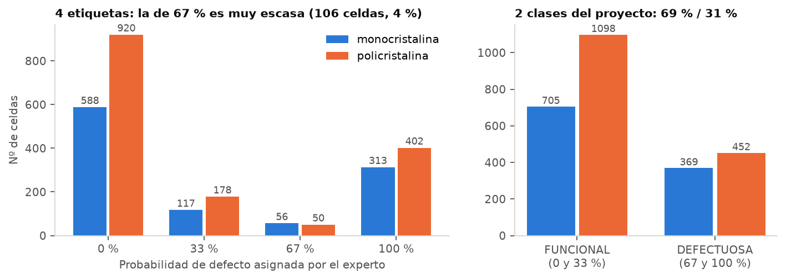

- Hay 1.803 celdas FUNCIONALES (68,7 %) y 821 DEFECTUOSAS (31,3 %), y el desbalance es parecido en mono y en poly.
- La etiqueta de 67 % solo tiene 106 celdas (4 %).

**Decisión:** el objetivo principal es en 2 clases. Las métricas son exactitud balanceada, F1 de la clase defectuosa y AUC, siempre por separado para mono y poly. Al entrenar se usan pesos por clase. El objetivo en 4 clases queda como secundario.

## 2. Cómo se ven

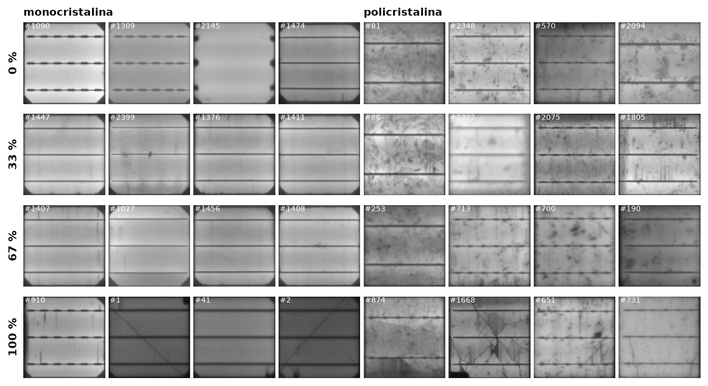

- Las grietas son líneas oscuras finas y las zonas desconectadas, manchas negras.
- **Mono:** el fondo es liso y los defectos resaltan.
- **Poly:** los granos del silicio forman manchas que parecen defectos. Es el caso difícil.
- Los busbars (3 bandas horizontales) y los dedos (líneas verticales tenues) son estructura normal de la celda.

## 3. Paneles

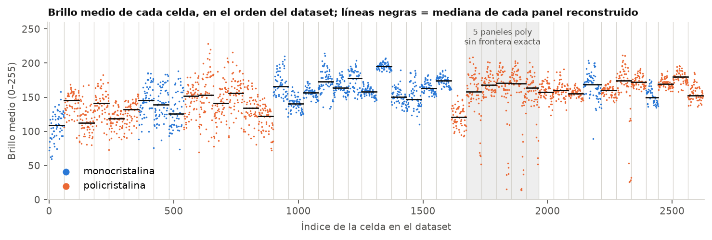
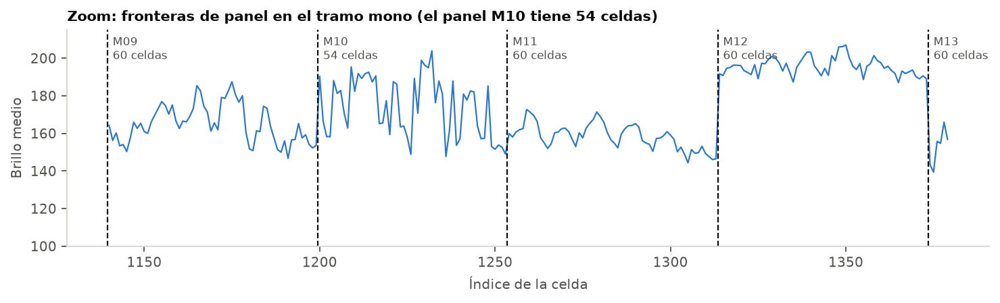

- Cada panel tiene su propio nivel de brillo, que depende de la exposición. Los saltos permiten reconstruir los 44 paneles (detalle en `01_dataset.md` §5).

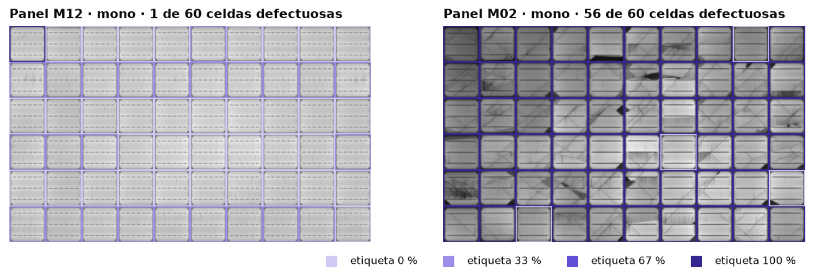
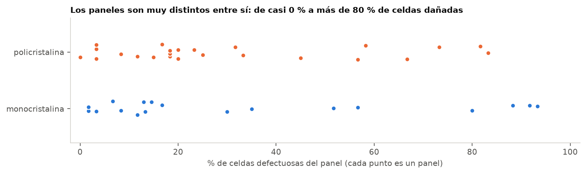

- Los paneles son muy distintos entre sí: el porcentaje de celdas dañadas va de 0 % a 93 %.

**Decisión:** la partición se hace **por panel**. Si se mezclan celdas de un mismo panel entre entrenamiento y prueba, el modelo puede acertar reconociendo el panel (su brillo, su lote de obleas) y no el defecto.

## 4. Brillo

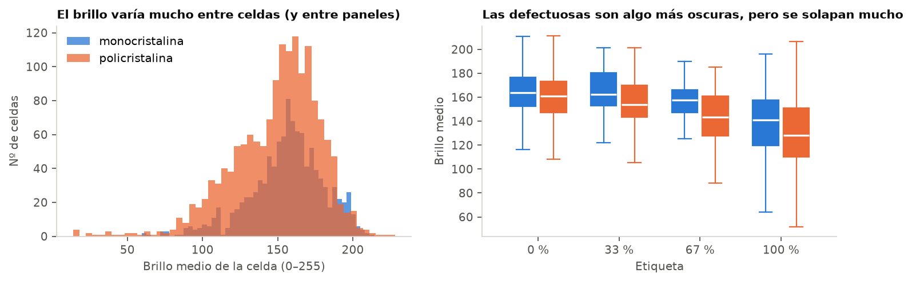

- El brillo depende más del panel que del defecto. Las defectuosas son algo más oscuras, pero las distribuciones se solapan mucho.
- Hay 11 celdas totalmente apagadas, todas poly y todas con etiqueta 100 %. Además, 15 celdas tienen más de 1 % de píxeles saturados.

**Decisión:** normalizar cada celda por su propio nivel de brillo (percentil 90) antes de buscar zonas oscuras. Las celdas apagadas se resuelven con una regla y se reportan aparte.

## 5. Estructura fija y Fourier

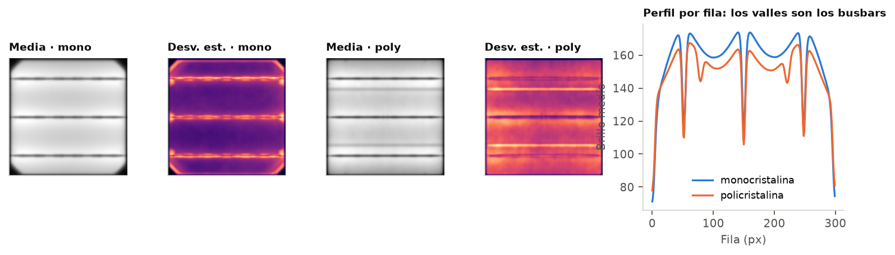
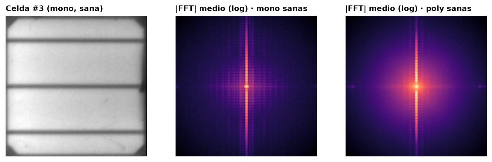

- Los busbars son horizontales y periódicos: casi siempre 3, aunque ~359 celdas poly tienen 2. En el espectro de Fourier aparecen como una **columna de picos en el eje vertical**. Los dedos producen picos débiles en el eje horizontal.

**Decisiones:**
- Los busbars se detectan en cada celda (perfil por filas), no con una máscara fija.
- **Comparación de dos alternativas** (la pide el curso): quitar los busbars con un **filtro notch en Fourier** (lab 9) frente a un **cierre morfológico** (lab 10, la línea base actual), y elegir con métricas medidas en validación.

## 6. Celdas casi idénticas y paneles gemelos

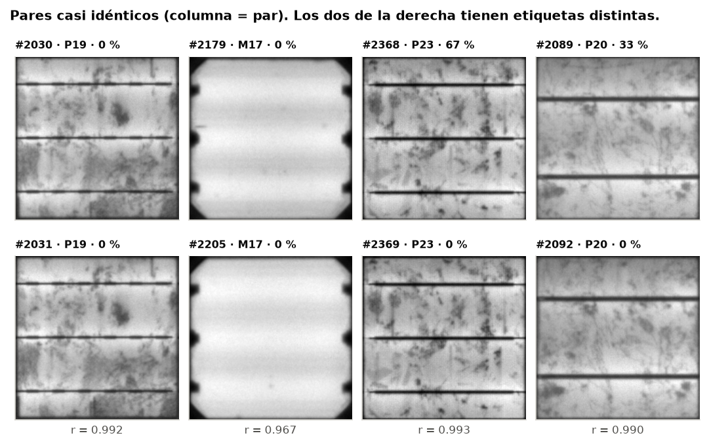

| Umbral | Pares | % en el mismo panel | Pares con distinta clase |
|---|---|---|---|
| r > 0,90 | 4.118 | 82,5 % | 417 |
| r > 0,95 | 1.193 | 96,2 % | 95 |
| r > 0,98 | 124 | 99,2 % | 6 |

- Celdas consecutivas de un panel vienen de obleas consecutivas del mismo lingote, y por eso son casi idénticas.
- Hay **5 pares de paneles gemelos**, que muy probablemente son el mismo panel fotografiado dos veces (P14 = P22 es inequívoco).
- Algunos pares casi idénticos tienen etiquetas distintas: es ruido de etiqueta.

**Decisión:** los gemelos se unen en un solo grupo de partición. Hay que esperar un techo de exactitud, ~88 % en la literatura.

## 7. Línea base del preprocesamiento (código de arranque)

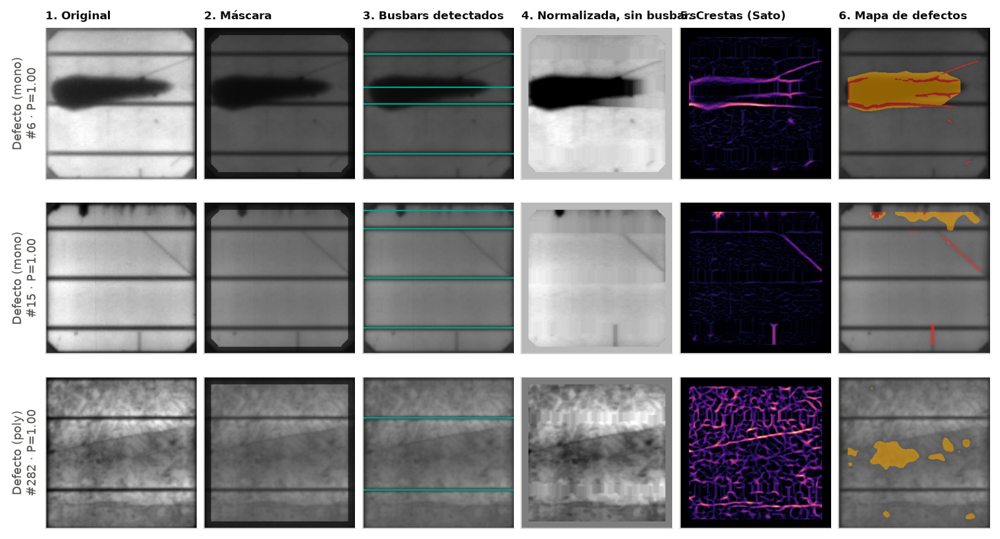

El pipeline actual (`src/preproc.py`) funciona bien en monocristalinas, con grietas nítidas. La figura muestra dónde mejorarlo:

- **Fila 1:** la mancha oscura grande se confunde con un busbar (paso 3). Hace falta exigir que el busbar sea fino y abarque todo el ancho.
- **Fila 3 (poly):** el filtro de crestas responde a todos los bordes de grano, y la grieta diagonal no se distingue en el mapa final. Hace falta filtrar por orientación, longitud y escala, o probar Gabor.
- **Pendientes:** corregir la iluminación no uniforme y probar el notch en Fourier.

Resultado previo (27-oct, sin la partición actual): las características del mapa de defectos más una regresión logística dan ≈ 78 % de exactitud (AUC 0,84). **Hay que volver a medirlo** con `scripts/02_evaluar_caracteristicas.py` sobre la partición congelada.

## 8. Tabla resumen

| Hallazgo | Decisión |
|---|---|
| 2.624 celdas completas, sin faltantes ni duplicados exactos | Se usan todas |
| Desbalance 69/31; la clase 67 % tiene 106 celdas | 2 clases; métricas balanceadas; pesos por clase |
| 44 paneles muy distintos entre sí | Partición por panel |
| Casi duplicados dentro del panel; 5 pares de paneles gemelos | Gemelos juntos; verificar fuga |
| El brillo depende del panel | Normalizar cada celda |
| Busbars periódicos, 2 o 3 por celda | Detectarlos por celda; notch en Fourier vs. morfología |
| En poly, los granos parecen defectos | Separar textura de grieta (orientación, longitud, escala) |
| 11 celdas apagadas, todas defectuosas | Regla de brillo; se reportan aparte |
