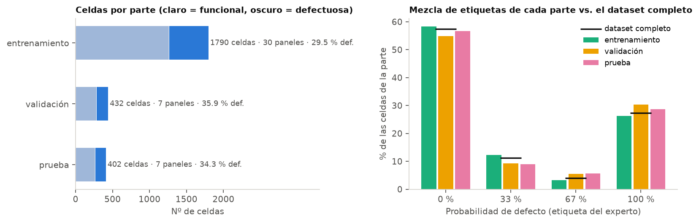
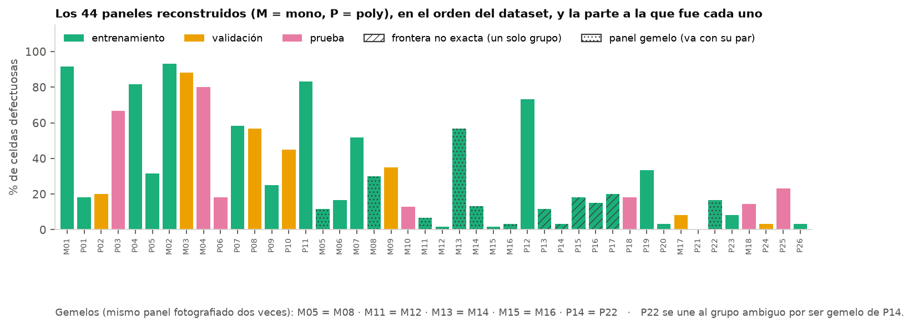

# 03 · Partición entrenamiento / validación / prueba

> **Regla de oro: la partición está congelada en [`data/particion.csv`](../data/particion.csv). Nadie la cambia.**
> Si hay que regenerarla (`python scripts/00_crear_particion.py`), el resultado tiene que ser idéntico; git muestra cualquier diferencia.

## 1. Para qué sirve cada parte

| Parte | Para qué se usa | Qué NO se hace con ella |
|---|---|---|
| **train** (entrenamiento) | Ajustar todo: parámetros del preprocesamiento, umbrales, características, pesos de la red, plantillas de máscara, media y desviación para normalizar | — |
| **val** (validación) | Comparar alternativas (p. ej., notch vs. morfología), elegir hiperparámetros y la época de la red, hacer el análisis de errores durante el desarrollo | Entrenar con ella |
| **test** (prueba) | **Una sola medición final**, con el sistema ya congelado. Es la "prueba con datos nuevos" que pide el curso y la base de la demo | Mirarla para decidir cualquier cosa. Si se usa para ajustar, deja de medir generalización |

## 2. Método

1. **Unidad indivisible = grupo.** El grupo es el panel, salvo en dos casos:
   - los 5 paneles poly sin frontera exacta (P13–P17) forman un solo grupo;
   - los paneles gemelos (M05 = M08, M11 = M12, M13 = M14, M15 = M16, P14 = P22) van juntos. Como P22 es gemelo de P14, se une al bloque P13–P17.

   Resultado: 44 paneles agrupados en 35 grupos.
2. El grupo grande, P13–P17 + P22 (350 celdas), va **siempre a entrenamiento**: en prueba sería casi toda la parte.
3. Validación y prueba reciben cada una **~15 % de las celdas de cada tipo** (mono y poly), por separado.
4. Se prueban **300.000 asignaciones al azar** (semilla `2026`) y se elige la que deja la mezcla de las 4 etiquetas de cada parte, por tipo, más parecida a la del dataset completo. Se exige además que haya al menos 10 celdas de la clase 67 % en validación y en prueba.

Código: [`src/particion.py`](../src/particion.py) · Ejecución: [`scripts/00_crear_particion.py`](../scripts/00_crear_particion.py) (~4 min).

## 3. Resultado

| Parte | Paneles | Celdas | % | mono | poly | 0 % | 33 % | 67 % | 100 % | FUNC. | DEF. | % def. | % def. mono | % def. poly |
|---|---|---|---|---|---|---|---|---|---|---|---|---|---|---|
| train | 30 | 1.790 | 68,2 | 720 | 1.070 | 1.043 | 219 | 59 | 469 | 1.262 | 528 | 29,5 | 31,5 | 28,1 |
| val | 7 | 432 | 16,5 | 192 | 240 | 237 | 40 | 24 | 131 | 277 | 155 | 35,9 | 41,7 | 31,2 |
| test | 7 | 402 | 15,3 | 162 | 240 | 228 | 36 | 23 | 115 | 264 | 138 | 34,3 | 38,3 | 31,7 |
| total | 44 | 2.624 | 100 | 1.074 | 1.550 | 1.508 | 295 | 106 | 715 | 1.803 | 821 | 31,3 | 34,4 | 29,2 |

| Parte | Paneles |
|---|---|
| val | M03, M09, M17, P02, P08, P10, P24 |
| test | M04, M10, M18, P03, P06, P18, P25 |
| train | los 30 restantes (incluye todos los gemelos y el bloque P13–P17 + P22) |




**Observación:** validación y prueba quedaron con algo más de celdas defectuosas (36 % y 34 %) que entrenamiento (30 %). Es el costo de no poder dividir paneles: con solo 44 paneles muy distintos entre sí no se puede igualar más sin romper grupos. Por eso se reportan métricas balanceadas, que no dependen de la proporción de clases.

## 4. Verificación de fuga

Se cuentan los pares de celdas casi idénticas (correlación r alta; ver `02_eda.md` §6) que quedan en **partes distintas**. Como referencia se compara con una partición al azar por celda (estratificada, 70/15/15), que es el error típico:

| Umbral | Pares | Repartidos entre partes: **por panel (nuestra)** | Repartidos: al azar por celda |
|---|---|---|---|
| r > 0,95 | 1.193 | **0** | 498 (280 train–val, 186 train–test) |
| r > 0,90 | 4.118 | **7** (0 train–val, 2 train–test, 5 val–test) | 1.769 |

Con la partición por panel prácticamente no quedan celdas "gemelas" a ambos lados. Con una partición al azar, cientos de celdas de prueba tendrían una casi copia en entrenamiento y los resultados saldrían inflados. Los números completos están en [`data/particion_info.json`](../data/particion_info.json).

## 5. Cómo usarla en el código

```python
import pandas as pd
part = pd.read_csv("data/particion.csv")
train = part[part.split == "train"]; val = part[part.split == "val"]; test = part[part.split == "test"]
# las imágenes: from datos import cargar_imagenes; ims = cargar_imagenes(); ims[train.idx]
```

Reglas prácticas:
- Todo lo que se "aprende" de los datos (medias, umbrales, plantillas, normalización de la red) se calcula **solo con train**.
- Las comparaciones entre alternativas se hacen en **val**.
- **test** se evalúa una sola vez al final (`EVALUAR_TEST=1` en `scripts/04_entrenar_cnn.py`), y el número que salga es el que va al informe.
- Si se aumentan los datos (volteos, traslaciones), solo se aumentan las celdas de train.
